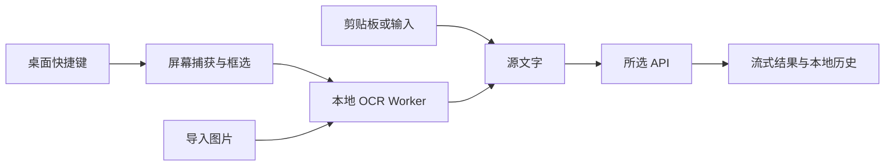

# 架构与性能

Tauri 2 提供系统 WebView、快捷键、截图和系统密钥存储；React + TypeScript 共享界面、OCR 调度、配置和流式翻译逻辑。

## 数据流

API 仅接收识别后的文本。原生版使用原生 HTTP 客户端，浏览器预览受 CORS 限制。配置和历史本地保存；密钥独立存储，具体平台差异见 [平台能力](platforms.md)。

Windows 使用 xcap 捕获鼠标所在屏幕；macOS 调用系统 `screencapture` 整屏捕获，读取并删除私有临时文件后交给框选层。两个平台均在原生层裁剪，松开选区即开始识别。

## 减少等待

- 应用启动时预加载框选窗口；图片解码就绪后显示，避免空白遮罩。
- OCR 使用单个持久 Worker，按需加载语言，并在桌面空闲时预热；排队中的任务取消后立即返回，图片字节缓冲区移交给 Worker，避免整图再复制一次。
- 剪贴板和手动输入直接翻译，跳过图像处理。
- API 首段到达立即显示，后续片段按动画帧合并刷新。停止、复制、分享或交换方向先取出全部已收到的文本，防止尚未绘制的尾部丢失；新任务取消旧请求，通过任务标识阻止过期结果覆盖。
- SSE 解析器只扫描新片段，完整行再拼接，不反复扫描未结束的长行。大小限制按事件计算，避免同一网络片段里的多个合法事件被误拒绝。
- 截图会话使用独立标识，窗口准备作为一次 UI 线程转换，在执行时重新检查会话；取消后的迟到准备不会重新全屏或隐藏主窗。
- 系统密钥存储操作在后台线程串行执行，避免阻塞窗口线程。
- ChatGPT 连接与账号列表来自同一次凭据快照；模型目录返回时再次核对当前连接，防止旧账号响应覆盖新状态。

OCR 的 Worker、WASM 和语言模型在开发/构建阶段准备，随应用打包。首次准备需要联网，运行时识别无需下载模型。

## 状态与数据完整性

服务模板与编辑器共享一个互斥弹窗状态。原生输入不会覆盖未保存的服务草稿；页面内翻译快捷键仅在翻译页且没有弹窗时生效，忽略按键连发、输入法组合输入和正在进行的翻译。弹窗限制键盘焦点，关闭时返回入口。

流式文本缓冲与模态焦点分别由 `src/hooks/` 管理，网络、OCR 和持久化规则留在 `src/lib/`。历史保留完整合法译文；超过总容量时淘汰旧条目，单条完整结果仍放不下则报告未保存并保留旧历史，避免静默截断译文。

## 尚待改进

- `App.tsx` 仍承担任务编排和较多界面布局；后续功能应继续按任务状态和页面拆分，避免一次大范围重写取消与凭据提交时序。
- Windows GNU 打包仍临时调整 `Cargo.toml` 的库类型并在 `finally` 恢复，强制终止进程可能留下调整后的文件。单独传 `--bin` 仍会触发库的其他 crate types，不能替代此步骤；后续应使用隔离构建工作区或拆分移动库入口。MSVC 路径不需要该调整。
- CI 的 Rust stable、Node 22 和 runner latest 尚未全部固定到精确工具链，完整逐平台 SBOM / 许可证集合仍待补齐。

## 性能验证

尚未完成冷启动、内存占用、热态截图或 OCR 的设备基准。当前策略不构成速度保证；macOS 的子进程与 PNG 读写开销也需实测。

使用固定设备、截图和 API，分别记录冷启动与至少 20 次热态请求的中位数及 p95：

| 阶段 | 测量区间 |
| --- | --- |
| 截图响应 | 按下快捷键 → 框选层可交互 |
| OCR | 选区提交 → 源文字可用 |
| 请求准备 | 源文字可用 → API 请求发出 |
| API 首字 | 请求发出 → 首个翻译字符显示 |
| 完整翻译 | 请求发出 → 流结束 |

用户拖动选区的时间单独统计。比较 OCR 方案时同时记录正确率、耗时、模型体积和内存，再决定是否增加其他识别后端。
