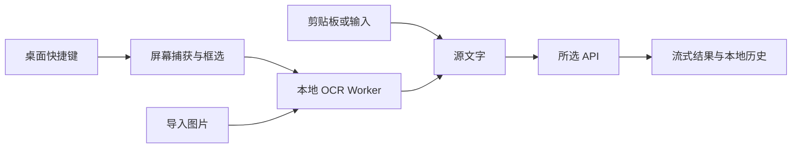

# 架构与性能

Tauri 2 提供系统 WebView、快捷键、截图和系统密钥存储；React + TypeScript 共享界面、OCR 调度、配置和流式翻译逻辑。

## 数据流

API 仅接收识别后的文本。原生版使用原生 HTTP 客户端，浏览器预览受 CORS 限制。配置和历史本地保存；密钥独立存储，具体平台差异见 [平台能力](platforms.md)。

Windows 使用 xcap 捕获鼠标所在屏幕；macOS 调用系统 `screencapture` 整屏捕获，读取并删除私有临时文件后交给框选层。两个平台均在原生层裁剪，松开选区即开始识别。

## 减少等待

- 应用启动时预加载框选窗口；图片解码就绪后显示，避免空白遮罩。
- OCR 使用单个持久 Worker，按需加载语言，并在桌面空闲时预热。
- 剪贴板和手动输入直接翻译，跳过图像处理。
- API 首段到达立即显示；新任务取消旧请求，通过任务标识阻止过期结果覆盖。
- 截图会话使用独立标识，迟到的完成或取消不会影响下一次截图。
- 系统密钥存储操作在后台线程串行执行，避免阻塞窗口线程。

OCR 的 Worker、WASM 和语言模型在开发/构建阶段准备，随应用打包。首次准备需要联网，运行时识别无需下载模型。

## 性能验证

尚未完成冷启动、内存占用、热态截图或 OCR 的设备基准。当前策略不构成速度保证；macOS 的子进程与 PNG 读写开销也需实测。

使用固定设备、截图和 API，分别记录冷启动与至少 20 次热态请求的中位数及 p95：

| 阶段 | 测量区间 |
| --- | --- |
| 截图响应 | 按下快捷键 → 框选层可交互 |
| OCR | 选区提交 → 源文字可用 |
| 请求准备 | 源文字可用 → API 请求发出 |
| API 首字 | 请求发出 → 首个翻译字符显示 |
| 完整翻译 | 请求发出 → 流结束 |

用户拖动选区的时间单独统计。比较 OCR 方案时同时记录正确率、耗时、模型体积和内存，再决定是否增加其他识别后端。
